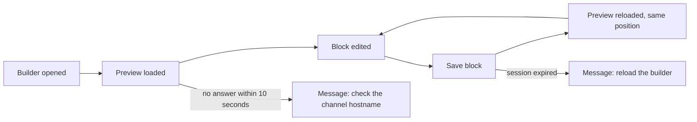

_Questions and Parcours are regenerated by `/developer:archive-spec`: do not edit them by hand, changes would be overwritten on the next run. Nouveautés is cumulative._

## Questions

### Why does the preview say "The preview did not answer"? {#preview-unreachable}
The preview did not answer within 10 seconds. When the administration has its own address, every channel needs its hostname, otherwise the preview looks for the page in the wrong place.
1. Open "Channels" in the Configuration menu.
2. Open the channel of the page and check that its hostname is filled in.
3. Reload the page builder.

If the hostname is already filled in, send the page address to the technical team.

### What should I do when the builder says my session has expired? {#session-expired}
The administration session expired while editing: the builder can no longer reload the preview. Reload the builder page, log in again if needed, then go on editing. Blocks already saved are kept.

### Why do the links of the preview lead nowhere? {#links-disabled}
In the page builder, the links and forms of the preview are disabled so that you stay on the page being edited. To follow a link, use "View published page".

### What does the "The page has changed" alert mean? {#page-changed}
The preview shows another page than the one being edited. For safety, block editing is suspended. Reload the page builder to go on.

### Why does the preview address stop working after a few minutes? {#preview-link-expired}
The preview opens through a temporary address, valid for a few minutes and for one page and one language only. Once expired, it shows an access refusal. It is not a link to share: to show a page, use "View published page" or open the builder again.

### Why does a block show "No visible output in the preview"? {#empty-block}
The block exists but shows nothing at this screen size: missing content, a part that only appears on another device, a pop-up or an invisible tool. The dashed frame gives its icon and name so you can still find it.
1. Hover the frame and click the edit button on the right.
2. Fill in the missing content, then save.

If the frame stays after saving, check the block on another screen size (desktop, tablet, mobile buttons).

### Why are the preview buttons in my language while the page is in another one? {#preview-language}
The edit button, the block states and the block names follow the language of your administration, not the language of the page. The content of the page itself stays in its own language.
### How do I make the editing panel wider or narrower? {#resize-panel}
Drag the left edge of the editing panel: to the right to see more of the page, to the left to give the form more room. The width is remembered by your browser, also after a reload.
1. Hover the left edge of the panel until the cursor becomes a double arrow.
2. Drag it, then release.
3. Double-click the edge to go back to the default width.

With the keyboard, move the focus to the edge, then use the left and right arrows. On another computer or browser, the panel opens at its default width.

## Parcours

## Nouveautés

- 2026-11-26 : the page builder works when the administration has its own address; the preview reloads at the same position after each save, and a message explains an unreachable preview or an expired session.
- 2026-11-26 : a block that shows nothing in the preview now displays a frame with its icon and name; edit buttons are never cut; the preview texts follow the language of the administration.
- 2026-11-26 : the block editing panel can be resized by dragging its left edge, and the browser remembers its width.
